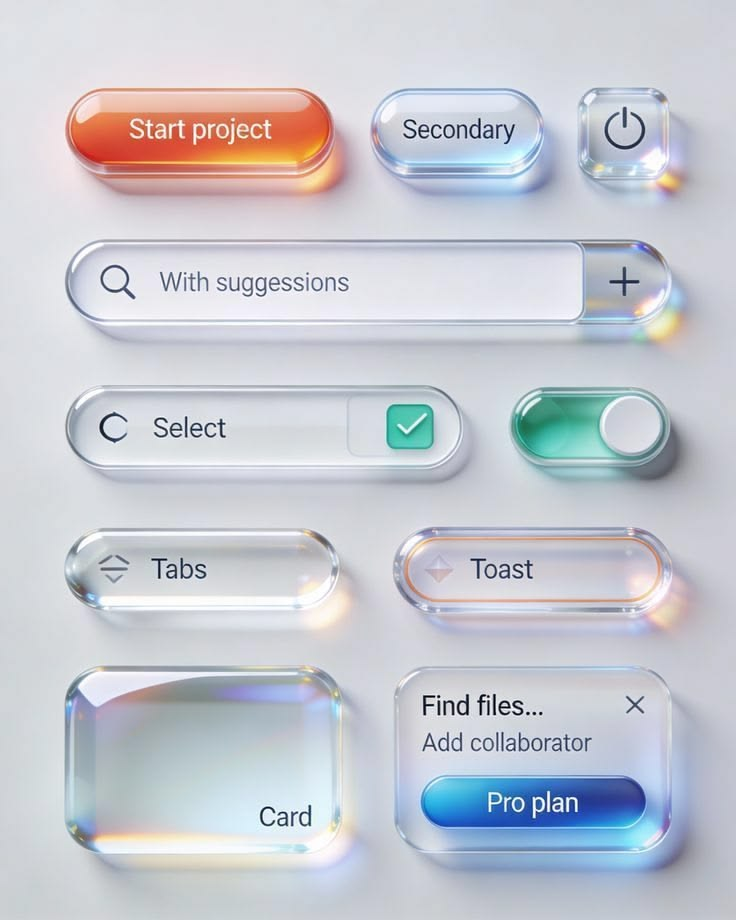

<div align="center">

# Refractor Optical Glass UI Kit

**A tactile, multi-material & optical-glass React 19 & TypeScript component library with Astryx Open-Internals architecture, 68 full-transformation themes (5 Optical Glass + 63 WebOS-v3 themes), and 314 accessible components across 55 categories.**

[](https://github.com/SourceCode/refractor-ui/releases/tag/v1.49.0)
[](https://sourcecode.github.io/refractor-ui/)
[](https://react.dev/)
[-3178C6?style=flat-square&logo=typescript&logoColor=fff)](https://www.typescriptlang.org/)
[](./docs/adr/ADR-0005-testing-adversarial-coverage-and-security-verification.md)
[](./docs/reviews/ux-ui-director-audit.md)
[](./LICENSE)

[**Live Interactive Documentation & Optical Workbench →**](https://sourcecode.github.io/refractor-ui/)  
[30 Example Screens](https://sourcecode.github.io/refractor-ui/#/examples) · [Getting Started](https://sourcecode.github.io/refractor-ui/#/getting-started) · [Theming & Theme Studio](https://sourcecode.github.io/refractor-ui/#/theming) · [CLI & Swizzle](https://sourcecode.github.io/refractor-ui/#/cli) · [Architecture & Security](https://sourcecode.github.io/refractor-ui/#/architecture)

</div>

---

<p align="center">
  
</p>

## Why Refractor UI?

- **314 Production Components Across 55 Categories:** Spanning core optical controls, enterprise data grids & schedulers, rich content creation, AI chat & agent control surfaces, CLI & terminal multiplexers, media & 360° spatial viewers, security & auth, commerce & billing, mobile touch utilities, multi-agent orchestration, scheduling & formatted inputs, complex action controls, pro NLE/DAW transport, timeline, photo color grading, audio mixing/DSP, viewport/export tools, token-driven optical SVG charting/financial/scientific/observability/geospatial/storytelling suites, foundational micro-utilities, desktop OS windowing metaphors, knowledge & formula spreadsheet tools, 3D/shader inspectors, enterprise data ops & API consoles, hardware/IoT tactile surfaces, and full desktop OS file explorer, window management, launcher, system tray, hardware HUD, and native system dialog suites.
- **Astryx-Aligned Open-Internals Architecture:** Every primitive lives in `packages/core/src/<ComponentName>/` with `<Name>.tsx`, `<Name>.doc.mjs`, `<Name>.test.tsx`, and `index.ts` — using React 19 `ref`-as-prop (never `forwardRef`), `BaseProps<Element>`, `themeProps()`, `mergeProps()`, and tree-shakeable subpath exports.
- **68 Full-Transformation Multi-Material Themes (`@refractor-ui/themes`):**
  - **13 Material Archetypes & 9 GPU-Friendly FX Overlays:** Transform all 314 components across `glass`, `mica`, `bevel` (Windows 95/XP/Amiga/BeOS/Solaris), `brutalist` (Brutalist Web/Memphis/Paper Cutout/Industrial), `neon` (Cyberpunk/Synthwave/Outrun/Vaporwave/Blade Runner/Akira), `crt` (Hacker Terminal), `pixel` (Game Boy/SNES/Sega Genesis & Saturn), `neumorphic`, `clay` (Soft Clay), `paper` (E-Ink/Zen Garden), `chrome` (Y2K Liquid Chrome/Liquid Metal/PS5), `resin` (Glowing Resin/Slime/Dream Logic), and `flat` (VS Code/Monokai/One Dark Pro/Nord/Tokyo Night/Solarized/Material/Adwaita/Ubuntu/Mint) — plus all Elemental and Four Seasons themes and on-demand allowlisted Google Font loading. Certified **9.89/10 mean** across Web, Tablet, and Mobile in [`docs/reviews/webos-v3-themes-audit.md`](./docs/reviews/webos-v3-themes-audit.md).
  - **Single-Hex Color Derivation & Cascade Overrides:** Pass a single hex color to `createPrismTheme({ palette: { primary: { main: '#7C3AED' } } })` or compose cascading overrides with `defineTheme({ name, extends, material, fx, tokens, components })` inside CSS `@layer components` for seamless Tailwind CSS v4 interoperability.
- **Zero `any` and Zero `unknown` Strictness:** Enforced by `@typescript-eslint/no-explicit-any`, custom `@refractor/no-unknown-type`, and a 17-rule two-tier ESLint plugin (`internal/eslint-plugin-refractor`).
- **60fps Full-Application Performance Architecture (`v1.48.0–v1.49.0`, `1,750+` Improvements):** 314/314 pure `/*#__PURE__*/ memoWithDisplayName` tree-shakeable components + tree-shakeable `@refractor-ui/themes` subpath exports, 1,121 module-hoisted `stableClassName` resolvers, split `ComponentOverridesContext` (zero re-renders on theme/mode switches), 12px/14px GPU blur kernels + automatic nested & `[data-refractor-blur-host="true"]` blur elision, 100% inline `<svg>` & 16-table `content-visibility: auto` containment, 60fps `requestAnimationFrame` pointer-drag coalescing across all 36 drag components, three-tier GPU `performanceMode` (`balanced` / `high` / `max`), 3,103+ hoisted frozen style singletons, zero `transition-all`, and zero-allocation `mergeProps` hot paths — see [`docs/reviews/performance-audit-v1.49.0.md`](./docs/reviews/performance-audit-v1.49.0.md) and [`docs/reviews/performance-audit-v1.48.0.md`](./docs/reviews/performance-audit-v1.48.0.md).
- **Defense-in-Depth Security & 99.8%+ V8 Coverage:** Built-in XSS allowlist sanitization, URL protocol allowlisting, OWASP CSV formula neutralization, prototype-pollution-safe `Map` aggregations, ReDoS protection, path-traversal-hardened CLI swizzling, and `0` high/critical vulnerabilities.
- **30 Interactive Full-Code Example Screens (Web, Tablet & Mobile):** Explore live application templates for login, onboarding, MFA, executive analytics, financial reports, SRE telemetry, AI chat, autonomous agent workflows, cloud code IDEs, PR diff reviews, product catalogs, 360° product pages, new product forms, mobile banking, and tablet dispatch at [`#/examples`](https://sourcecode.github.io/refractor-ui/#/examples) — certified `9.85/10` mean in [`docs/reviews/example-screens-ux-audit.md`](./docs/reviews/example-screens-ux-audit.md).
- **Multi-Device Responsive Certified (Desktop, Tablet & Mobile):** Verified across 15 modern device viewports — including **Google Pixel 10 (`412×924`)**, Pixel 10 Pro / Pro XL, **Samsung Galaxy S25 (`360×780`)**, Galaxy Z Fold7 Cover (`344×882`), **iPhone 17 / 16 / Pro / Pro Max (`393×852`–`440×956`)**, **iPad mini / Pro 11" / Pro 13"**, and **Google Pixel Tablet** — backed by automated multi-device Vitest matrix validation (`apps/docs/src/docs/responsive.matrix.test.tsx`).
- **Creative UX/UI Director Certified (`9.95/10`):** Every component audited live across Light Mode, Dark Mode, Vivid Refraction, and custom palettes — see [`docs/reviews/ux-ui-director-audit.md`](./docs/reviews/ux-ui-director-audit.md).

---

## 30-Second Quick Start

### 1. Install

```bash
pnpm add @refractor-ui/core lucide-react
# Optional official optical theme presets:
pnpm add @refractor-ui/theme-alabaster @refractor-ui/theme-obsidian @refractor-ui/theme-amethyst
```

### 2. Import Layered Optical Stylesheets (`src/index.css`)

```css
@import "tailwindcss";
@source "../node_modules/@refractor-ui/core/dist";
@custom-variant dark (&:where(.dark, .dark *, [data-color-mode="dark"], [data-color-mode="dark"] *));

/* @layer base reset & @layer components optical physics */
@import "@refractor-ui/core/reset.css";
@import "@refractor-ui/core/refractor.css";
```

### 3. Theme & Render (`src/App.tsx`)

```tsx
import {
  PrismThemeProvider,
  createPrismTheme,
  PrismCard,
  PrimaryButton,
  SecondaryButton,
} from '@refractor-ui/core';

const brandTheme = createPrismTheme({
  palette: {
    mode: 'light',
    primary: { main: '#7C3AED' },
    secondary: { main: '#06B6D4' },
    success: { main: '#10B981' },
  },
  shape: { borderRadius: 18, slabRadius: 24 },
  optics: { refraction: 'vivid', blurPx: 20, specularHighlight: true },
});

export function App() {
  return (
    <PrismThemeProvider theme={brandTheme}>
      <PrismCard title="Custom Prismatic Brand" kicker="MUI + Astryx Cascade">
        <div className="flex gap-3 pt-2">
          <PrimaryButton size="md">Launch Studio</PrimaryButton>
          <SecondaryButton size="md">Explore Docs</SecondaryButton>
        </div>
      </PrismCard>
    </PrismThemeProvider>
  );
}
```

You can also import any primitive via tree-shakeable subpaths:

```tsx
import { PrimaryButton } from '@refractor-ui/core/PrimaryButton';
import { AdvancedDataGrid } from '@refractor-ui/core/AdvancedDataGrid';
import { NodeGraphCanvas } from '@refractor-ui/core/NodeGraphCanvas';
```

---

## Complete 314-Component Catalog (55 Categories)

| Category | Count | Components |
| --- | :---: | --- |
| **Buttons & Actions** | 6 | `PrimaryButton`, `SecondaryButton`, `IconButton`, `SegmentedControl`, `SplitButton`, `FloatingActionButton` |
| **Form Inputs & Selection Controls** | 11 | `TextInput`, `TextArea`, `SearchWithSuggestions`, `DropdownSelect`, `Checkbox`, `RadioGroup`, `ToggleSwitch`, `RangeSlider`, `DateTimePicker`, `FileDropzone`, `RatingControl` |
| **Navigation** | 7 | `TopNavBar`, `SidebarDrawer`, `PrismTabs`, `Breadcrumbs`, `Pagination`, `Stepper`, `CommandPalette` |
| **Data Display & Content** | 12 | `PrismCard`, `DataTable`, `PrismList`, `Avatar`, `BadgeStatus`, `TagChip`, `Accordion`, `CarouselSlider`, `TreeView`, `Timeline`, `CalendarView`, `OpticalCharts` |
| **Feedback & System Status** | 5 | `ToastSnackbar`, `AlertBanner`, `ProgressAndSpinner`, `SkeletonLoader`, `EmptyState` |
| **Overlays & Popups** | 5 | `ModalDialog`, `ContextualPopover`, `Tooltip`, `ContextMenuDropdown`, `SlideOverSheet` |
| **Layout & Workspace Controls** | 6 | `WindowSplitter`, `DockablePanel`, `MasterDetailView`, `VirtualizedList`, `MasonryGrid`, `StickyActionBar` |
| **Advanced Data & Visualization** | 6 | `AdvancedDataGrid`, `PivotTable`, `KanbanBoard`, `GanttChart`, `DiffViewer`, `KpiMetricCard` |
| **Advanced Search & Filtering** | 4 | `FacetedFilterBar`, `VisualQueryBuilder`, `MultiSelectCombobox`, `GlobalSearchModal` |
| **Rich Input & Content Creation** | 6 | `RichTextEditor`, `CodeEditor`, `ColorPicker`, `InlineEditableField`, `ImageCropper`, `SignaturePad` |
| **Interactive & Drag-and-Drop** | 3 | `TransferList`, `SortableList`, `NodeGraphCanvas` |
| **Collaboration & Guidance** | 4 | `NotificationCenter`, `CommentThread`, `LivePresenceIndicator`, `ProductTour` |
| **AI & Conversational Interfaces** | 6 | `ChatMessageStream`, `PromptComposer`, `ThinkingAccordion`, `CitationChip`, `ResponseActionBar`, `SplitArtifactCanvas` |
| **Media, Audio & Spatial Controls** | 6 | `CustomVideoPlayer`, `AudioWaveformPlayer`, `MediaLightbox`, `BeforeAfterSlider`, `InteractiveMapViewer`, `Product360Viewer` |
| **Security, Auth & Account Management** | 5 | `OtpCodeInput`, `PasswordStrengthMeter`, `SecretKeyField`, `RolePermissionsMatrix`, `ActiveSessionsList` |
| **Commerce, Billing & Conversion** | 5 | `PricingTierMatrix`, `ProductVariantSelector`, `ShoppingCartDrawer`, `PaymentCardInput`, `PromoCouponInput` |
| **Mobile, Touch & System Utilities** | 5 | `BottomNavigationBar`, `SwipeableActionRow`, `PullToRefresh`, `KeycapBadge`, `CookieConsentBanner` |
| **CLI & Terminal Surfaces** | 7 | `TerminalEmulator`, `CommandInputBar`, `LiveLogStreamer`, `CopyableCommandBlock`, `ProcessStatusPill`, `StructuredOutputViewer`, `TerminalMultiplexer` |
| **AI Agent Execution & Control** | 7 | `AgentPlanList`, `ToolCallCard`, `ApprovalGateCard`, `AgentControlBar`, `CheckpointRollbackStrip`, `InlineDiffReviewer`, `RecoveryRoutingCard` |
| **AI Context, Memory & Configuration** | 6 | `ContextTokenMeter`, `AttachedContextBar`, `ModelParameterSwitcher`, `MemoryPersonaInspector`, `ConnectedToolsDrawer`, `ConfidenceIndicator` |
| **Multi-Agent & Orchestration** | 4 | `AgentRosterRail`, `AgentExecutionTrace`, `HandoffDivider`, `ParallelComparisonView` |
| **Date, Time & Scheduling Fields** | 6 | `DateRangePicker`, `CombinedDateTimePicker`, `DurationInput`, `RecurrenceBuilder`, `MonthQuarterYearPicker`, `TimezoneSelector` |
| **Number, Currency & Formatted Type Fields** | 6 | `NumericStepper`, `ScrubbableNumberField`, `CurrencyInput`, `MeasurementUnitInput`, `InternationalPhoneInput`, `MaskedPatternInput` |
| **Complex Button & Action Variations** | 5 | `ComboSplitButton`, `HoldToConfirmButton`, `StatefulAsyncButton`, `MultiStateCycleButton`, `SpeedDialButton` |
| **Complex Variations of Common Controls** | 7 | `TriStateCheckbox`, `DualThumbSlider`, `HistogramRangeSlider`, `CascadingSelect`, `CreatableCombobox`, `RichSelectionCards`, `RotaryDial` |
| **Core & Trend Charts** | 5 | `LineMultiSeriesChart`, `AreaStackedChart`, `BarColumnChart`, `ComboDualAxisChart`, `SparklineChart` |
| **Part-to-Whole & Hierarchical Visuals** | 5 | `DonutPieChart`, `TreemapChart`, `SunburstChart`, `FunnelChart`, `WaterfallChart` |
| **Statistical & Distribution Visuals** | 5 | `ScatterBubblePlot`, `HistogramChart`, `BoxWhiskerPlot`, `MatrixHeatmap`, `RadarSpiderChart` |
| **Relational & Flow Visuals** | 3 | `SankeyDiagram`, `NetworkForceGraph`, `ChordDiagram` |
| **KPI, Progress & Telemetry Visuals** | 4 | `RadialGauge`, `BulletChart`, `CalendarHeatmap`, `LiveTelemetryChart` |
| **Geospatial & Map Visuals** | 3 | `ChoroplethMap`, `PointClusterMap`, `GeoFlowArcMap` |
| **Chart Chrome & Interactive Controls** | 4 | `InteractiveLegend`, `BrushRangeScrubber`, `ChartCrosshairTooltip`, `ChartThresholdMarker` |
| **Transport & Playback Controls** | 4 | `TransportControlBar`, `TimecodeScrubber`, `JogShuttleWheel`, `FrameStepperRateSelector` |
| **Timeline & Sequencing** | 6 | `MultiTrackTimeline`, `PlayheadScrubRuler`, `TrackHeaderStrip`, `ClipTrimHandle`, `KeyframeCurveEditor`, `TimelineZoomNavigator` |
| **Photo & Color Grading Controls** | 8 | `ToneCurveEditor`, `ThreeWayColorWheels`, `LiveColorScopes`, `CropStraightenOverlay`, `LayerBlendStack`, `EyedropperPixelLoupe`, `BrushHudControl`, `WipeCompareOverlay` |
| **Audio Mixing & Signal Processing** | 6 | `ChannelStripFader`, `VuPeakLevelMeter`, `StereoPanKnob`, `ParametricEqGraph`, `WaveformSpectrogramView`, `EffectsRackChain` |
| **Viewport & Export Utilities** | 2 | `CanvasZoomSafeAreaBar`, `ExportRenderQueue` |
| **Financial & Market Visualizations** | 5 | `CandlestickOhlcChart`, `OrderBookDepthChart`, `MarimekkoChart`, `CohortRetentionGrid`, `BurndownBurnupChart` |
| **Scientific, Statistical & High-Dimensional Visuals** | 7 | `ViolinPlot`, `RidgelinePlot`, `ParallelCoordinatesPlot`, `ContourDensityPlot`, `HexbinDensityPlot`, `PolarAreaRoseChart`, `SurfaceMesh3DPlot` |
| **System, DevOps & Observability Widgets** | 6 | `FlameGraphChart`, `DistributedTraceWaterfall`, `UptimeStatusBar`, `ServiceTopologyMap`, `CapacityAllocationStrip`, `AnomalyForecastChart` |
| **Comparison, Ranking & Storytelling Visuals** | 7 | `SlopegraphChart`, `BumpChart`, `DumbbellPlot`, `LollipopChart`, `WaffleUnitGrid`, `QuadrantMatrix`, `SmallMultiplesGrid` |
| **Foundational Primitives & Micro-Utilities** | 8 | `OpticalDivider`, `PropertyGrid`, `AvatarStack`, `InlineCopyTrigger`, `ExpandableTextClamp`, `MarqueeTicker`, `ShortcutCheatSheet`, `ScrollShadowArea` |
| **Desktop OS & Windowing Metaphors** | 7 | `AppDockBar`, `WindowTitlebar`, `AppMenuBar`, `WorkspaceStatusBar`, `MillerColumnsBrowser`, `RadialContextMenu`, `QuickLookPreviewer` |
| **Document, Knowledge & Spreadsheet Tools** | 7 | `SlashCommandMenu`, `BlockTransformHandle`, `FloatingTableOfContents`, `CalloutAdmonition`, `LinkPreviewCard`, `DocumentPageViewer`, `FormulaSpreadsheetGrid` |
| **Design, 3D & Shader Inspector Controls** | 7 | `VectorXyPad`, `TransformInspector`, `GradientStopEditor`, `SpringEasingPicker`, `OpticalMaterialInspector`, `AlignmentToolbar`, `AssetSwatchGrid` |
| **Enterprise Workflows, Data Ops & API Tooling** | 6 | `CsvColumnMapper`, `ApiRequestBuilder`, `FeatureFlagRollout`, `ApprovalChainStrip`, `AuditTrailFeed`, `SlaCountdownTimer` |
| **Hardware, IoT & Tactile Surfaces** | 5 | `StepSequencerMatrix`, `DigitalLedReadout`, `ThermostatDial`, `HardwarePortStrip`, `VirtualJoystickPad` |
| **File Explorer Navigation & Views** | 7 | `EditablePathBar`, `FileViewModeBar`, `DualPaneCommander`, `MountedVolumesSidebar`, `FileMetadataInspector`, `MarqueeSelectionBox`, `DirectoryFilterBar` |
| **File Management & Operations** | 6 | `FileTransferQueue`, `FileConflictDialog`, `BatchRenameUtility`, `PermissionsSharingMatrix`, `ArchiveInspector`, `TrashRecoveryBanner` |
| **Window Anatomy & Controls** | 5 | `MergedWindowTabBar`, `WindowResizeFrame`, `WindowUtilityControls`, `FloatingInspectorPalette`, `WindowAttachedSheet` |
| **Window Management & Desktop Tiling** | 6 | `SnapZoneOverlay`, `WindowLayoutPopover`, `WindowSwitcherOverlay`, `VirtualDesktopBar`, `WindowExposeGrid`, `MinimizedWindowTray` |
| **Menus & Launchers** | 5 | `CascadingSubmenu`, `RichContextMenu`, `AppLauncherMenu`, `SystemSpotlightLauncher`, `TearOffMenu` |
| **System Tray & Control Center** | 5 | `SystemTrayCluster`, `ControlCenterGrid`, `PerAppAudioMixer`, `NetworkVpnPopover`, `ClockCalendarPopover` |
| **Hardware HUDs & System Overlays** | 5 | `HardwareOsdHud`, `LockScreenOverlay`, `SessionPowerOverlay`, `TaskManagerDialog`, `ScreenCaptureHud` |
| **Desktop Surfaces & Native System Dialogs** | 5 | `DesktopIconCanvas`, `DesktopWidgetFrame`, `SystemPreferencesShell`, `SystemFileDialog`, `SystemAboutCard` |

---

## Agent-Ready CLI & Open Internals (`@refractor-ui/cli`)

Refractor follows a 5-step Open Internals escalation path: **Typed Props → Theme Tokens → Theme Component Overrides → Stable `refractor-*` Classes & `xstyle` → CLI Swizzle**.

```bash
node packages/cli/bin/refractor.mjs component --list
node packages/cli/bin/refractor.mjs component PrimaryButton --dense
node packages/cli/bin/refractor.mjs component TransferList --detail full
node packages/cli/bin/refractor.mjs docs theme --dense
node packages/cli/bin/refractor.mjs theme list
node packages/cli/bin/refractor.mjs swizzle PrimaryButton --out src/components/ui
node packages/cli/bin/refractor.mjs check --strict
```

---

## Monorepo Architecture & Local Development

```text
├── .github/                      # Issue/PR templates, SUPPORT, CODEOWNERS, Dependabot, CI/Pages templates
├── docs/
│   ├── adr/                      # Six authoritative Architecture Decision Records (ADR-0001..0006)
│   └── reviews/                  # Creative UX/UI Director visual audit (9.96/10 mean)
├── internal/
│   └── eslint-plugin-refractor/  # Custom 17-rule two-tier Astryx + zero any/unknown ESLint plugin
├── packages/
│   ├── core/                     # @refractor-ui/core — 314 React 19 components, theme engine, CSS tokens
│   ├── themes/                   # alabaster, obsidian, amethyst, emerald-tide, solar-prism
│   └── cli/                      # @refractor-ui/cli — docs, component, theme, swizzle, check
├── apps/
│   └── docs/                     # GitHub Pages Documentation Portal & Interactive Optical Workbench
└── scripts/                      # check-repo, sync-exports, run-strict-lint, build-pages
```

```bash
pnpm install
pnpm dev              # Launch Optical Workbench & Docs locally (http://localhost:3000)
pnpm check:repo       # Verify Astryx structure, SemVer lockstep & zero any/unknown
pnpm lint:plugin      # Run 16 unit tests for internal/eslint-plugin-refractor
pnpm lint:strict      # Run two-tier ESLint in CI/agent strict mode
pnpm typecheck        # Run strict TypeScript checks across core & docs
pnpm test:coverage    # Run 2,277+ Vitest unit & adversarial tests (>= 93% gate)
pnpm build            # Build packages/core and apps/docs
pnpm build:pages      # Build production GitHub Pages bundle (/refractor-ui/)
```

> **GitHub Actions Templates:** Ready-to-use workflows for CI, SemVer Release verification, and GitHub Pages deployment are provided in [`.github/ci-templates/`](./.github/ci-templates/). Copy them into `.github/workflows/` to enable automated Actions pipelines.

---

## Governance, Security & License

- **Versioning:** Strict [Semantic Versioning 2.0.0](https://semver.org/spec/v2.0.0.html) & [Keep a Changelog 1.1.0](./CHANGELOG.md).
- **Architecture Directives:** [`docs/adr/README.md`](./docs/adr/README.md) & [`AGENTS.md`](./AGENTS.md).
- **Contributing & Community:** [`CONTRIBUTING.md`](./CONTRIBUTING.md), [`CODE_OF_CONDUCT.md`](./CODE_OF_CONDUCT.md), and [`.github/SUPPORT.md`](./.github/SUPPORT.md).
- **Security Policy:** [`SECURITY.md`](./SECURITY.md).
- **License:** Apache License 2.0 — see [`LICENSE`](./LICENSE) and [`NOTICE`](./NOTICE).
